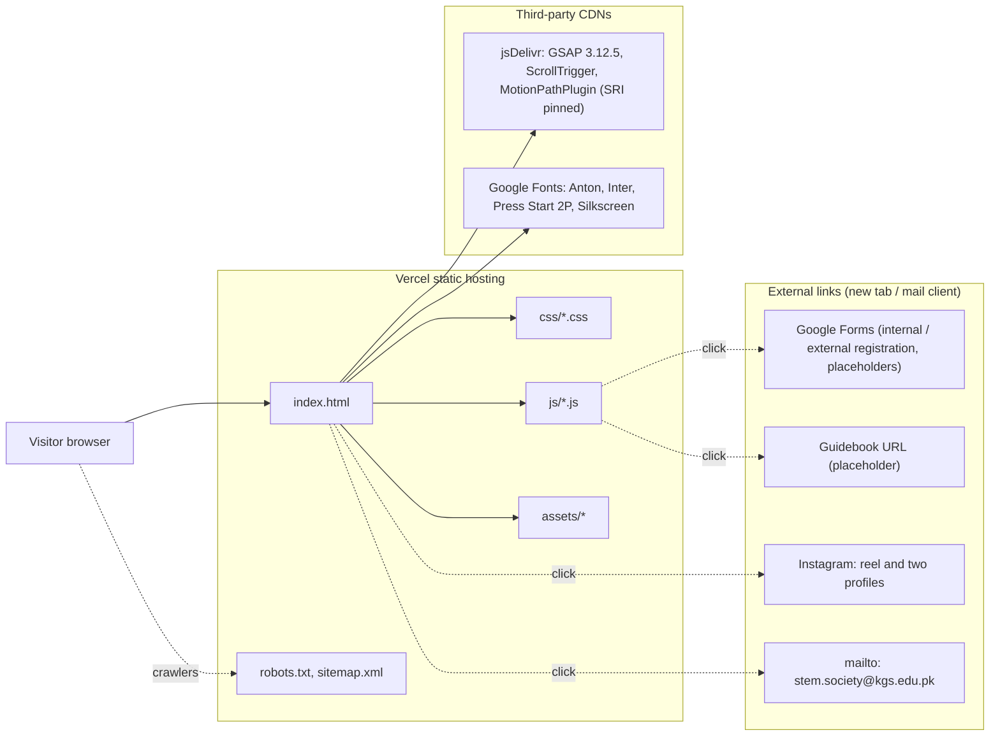
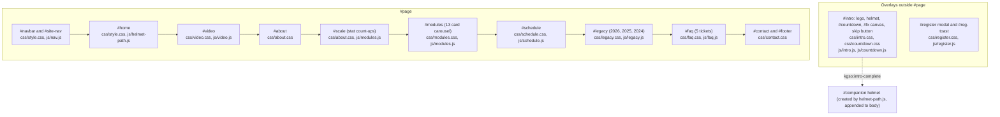
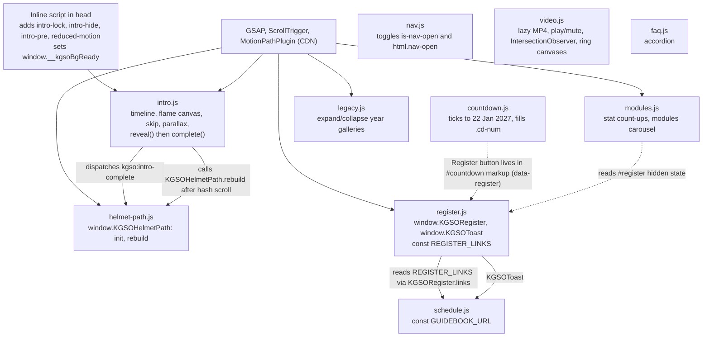
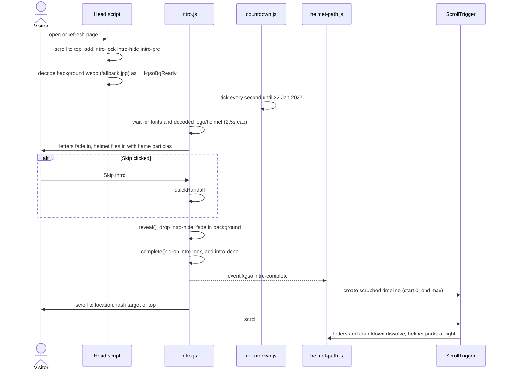
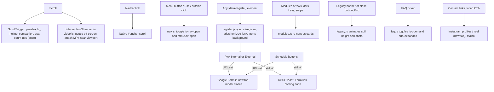
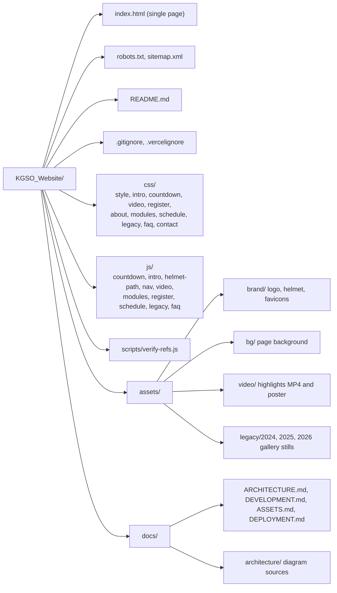

# Architecture

KGSO is a single static page (`index.html`) plus per-section CSS and vanilla JS files. There is no framework, bundler, package manager, backend or database. GSAP 3.12.5 (core, ScrollTrigger, MotionPathPlugin) and Google Fonts come from CDNs.

The diagrams below are embedded copies of the sources in [`docs/architecture/`](architecture/). Edit the source files, then paste the Mermaid block here (see [DEVELOPMENT.md](DEVELOPMENT.md)).

## Key runtime concepts

| Concept | Where | What it does |
|---|---|---|
| Intro gate classes on `<html>` | head script in `index.html`, `js/intro.js` | `intro-lock` (no scroll), `intro-hide` (page hidden), `intro-pre` (hero hidden until GSAP is ready; removed by an 8 s safety timeout), `intro-done` (set when finished), `reduced-motion` |
| `kgso:intro-complete` | dispatched by `intro.js` `complete()` | `helmet-path.js` initialises on it; the flame ticker in `intro.js` is removed on it |
| Companion helmet | `js/helmet-path.js` | Creates `#companion` and a scrubbed ScrollTrigger timeline; exposes `window.KGSOHelmetPath` (`init`, `rebuild`) |
| Registration popup | `js/register.js` | Any `[data-register]` opens `#register`; exposes `window.KGSORegister` (`open`, `close`, `links`, `toast`) and `window.KGSOToast` |
| Link placeholders | `REGISTER_LINKS` in `register.js`, `GUIDEBOOK_URL` in `schedule.js` | `'#'` means "not set": the click shows a "coming soon" toast |
| Mobile menu | `js/nav.js` | Toggles `is-nav-open` on `#navbar` and `nav-open` on `<html>` (max-width 900px) |
| Registration scroll lock | `js/register.js` | `reg-lock` on `<html>`, background siblings set `inert` |
| Persistence | head script | None. Only removes two old `sessionStorage` keys so the intro always plays |

## 1. System architecture

## 2. Application structure

`css/about.css` also holds the shared `kx-*` section styles used by About, Scale, Modules, Schedule, Legacy, FAQ and Contact. `css/style.css` holds the global base, navbar, background and companion helmet.

## 3. Component and module relationships

Scripts are all `defer`red and run in the order listed in `index.html`.

## 4. Data and interaction flow

Page load and intro:

Interactions after load:

## 5. Repository structure

