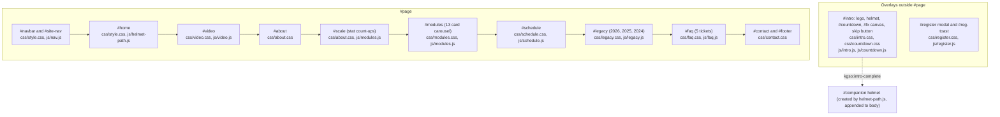

# Application structure

Everything lives in one page, `index.html`. Sections appear in document order below, with the CSS and JS that drive each. `css/about.css` also holds the shared `kx-*` section styles (title row, panels, sparks) used by About, Scale, Modules, Schedule, Legacy, FAQ and Contact. `css/style.css` holds the global base, navbar, background and the companion helmet.

