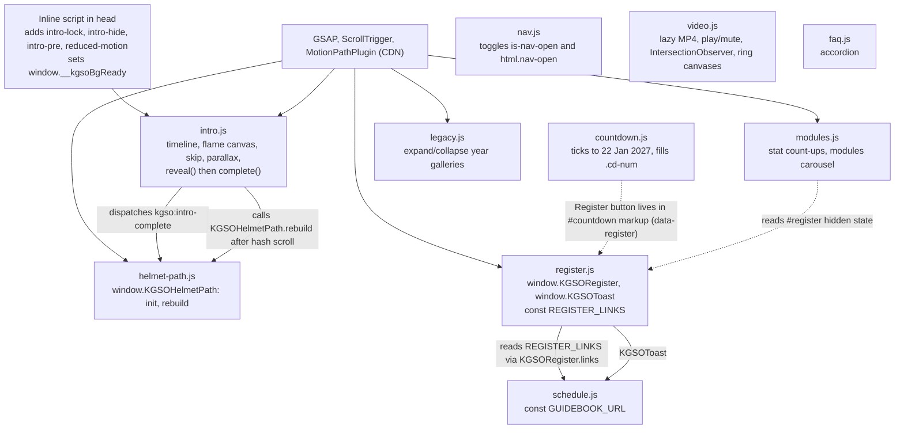

# Component and module relationships

How the JS files depend on each other. Scripts are all `defer`red and run in the order listed in `index.html`: GSAP libs, `countdown`, `intro`, `helmet-path`, `nav`, `video`, `modules`, `register`, `schedule`, `legacy`, `faq`.

Notes:

- `modules.js` only reads `#register` (`modal.hidden`) so carousel arrow keys are ignored while the popup is open.
- `schedule.js` falls back to writing into `#reg-toast` itself if `KGSOToast` is missing.
- `intro.js`, `helmet-path.js` and `legacy.js`/`modules.js` degrade when GSAP is absent (intro completes immediately; helmet-path and legacy return early).
- `window.__kgsoIntro` is a debug handle for the intro timeline; nothing in the site depends on it.
