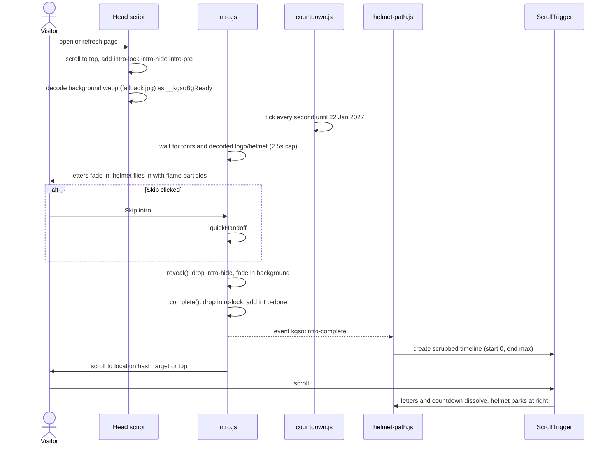
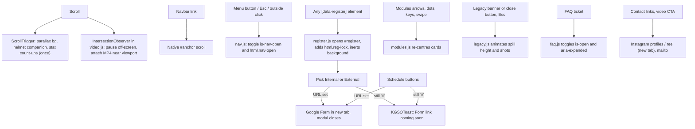

# Data and interaction flow

No data is persisted. The head script calls `sessionStorage.removeItem` for two legacy keys (`kgso_skip_intro`, `kgso_intro_seen`) so the intro always plays; nothing is written to `localStorage` or `sessionStorage`. There are no network requests besides static files, the CDNs and outbound links.

## Page load and intro

## User interactions after load

